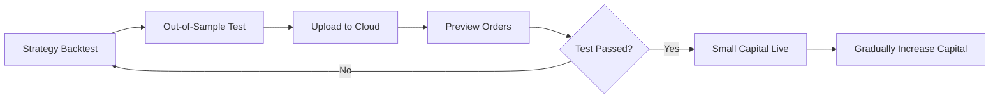

# finlab.online

`finlab.online` turns a backtest's target holdings into real orders in a broker account. `Position` works out how many shares to hold, and `OrderExecutor` compares that with what the account holds and places the orders that close the gap. It connects to Charles Schwab for U.S. stocks, several Taiwan brokers, and Binance for crypto.

> [!CAUTION]
> **Important risk warning**
>
> **Live trading involves real money. Errors can lead to financial losses!**
>
> **Mandatory safety principles**:
>
> 1. Always preview orders with `view_only=True` and start with a small account
> 2. Start with no more than 10-20% of total capital
> 3. Monitor positions and order status daily
> 4. Set stop-loss mechanisms to avoid large single losses
> 5. Use separate accounts for development/testing and production environments
> 6. NEVER use all capital on an untested strategy
> 7. NEVER ignore error messages or abnormal states

## Which function to use

| You want to | Use |
|---|---|
| Turn a backtest report into the holdings to own now | `Position.from_report()` |
| Turn weights and capital into quantities | `Position.from_weight()` |
| Write the symbols and quantities yourself | `Position()` |
| Connect to a broker | The broker's account class, e.g. `SchwabAccount()` |
| Preview, then sync the account to the target | `OrderExecutor(...).create_orders()` |
| Reprice unfilled limit orders | `executor.update_order_price()` |
| Cancel all open orders | `executor.cancel_orders()` |
| Check order status | `account.get_orders()`, which returns `Order` objects |
| Combine several strategies, then trade | `PortfolioSyncManager`, see [finlab.portfolio](https://studio.finlab.finance/en/docs/reference/portfolio) |

## From backtesting to live trading



**Recommended timeline**:

1. Strategy backtesting (1-2 weeks): Confirm logic is correct
2. Out-of-sample testing (2-4 weeks): Use unseen data
3. Order previews (4-8 weeks): Run the full workflow daily with `view_only=True`
4. Small capital live (8-12 weeks): 10-20% capital test
5. Gradual expansion (as appropriate): Increase capital only after confirming stability

## Place your first automated orders

Run the strategy, size the holdings, connect to the broker and preview the orders. `view_only=True` only prints the orders; remove it once they look right.

```python
import os

from finlab import data
from finlab.backtest import sim
from finlab.online.order_executor import OrderExecutor, Position
from finlab.online.schwab_account import SchwabAccount

# 1. Run the strategy on the U.S. market
data.set_market('us')
with data.us_universe(index='SP500'):
    close = data.get('price:adj_close')
position = (close / close.shift(126)).is_largest(20)
report = sim(position, resample='M', upload=False)

# 2. Turn the latest target weights into share quantities for $100,000
target = Position.from_report(report, fund=100_000)

# 3. Connect to Charles Schwab (pip install schwab-py)
os.environ['SCHWAB_API_KEY'] = 'YOUR_APP_KEY'
os.environ['SCHWAB_SECRET'] = 'YOUR_APP_SECRET'
os.environ['SCHWAB_TOKEN_PATH'] = '/path/to/token.json'
account = SchwabAccount()

# 4. Preview the orders, then place them
executor = OrderExecutor(target, account=account)
executor.create_orders(view_only=True)  # prints the orders, places nothing
# executor.create_orders()  # places the orders
```

`SchwabAccount` reads an existing token file created with the [schwab-py](https://schwab-py.readthedocs.io/) authentication flow. Taiwan broker setup is covered in the [single-strategy order tutorial](order_api.md).

## Connect a broker account

Each broker has its own account class. They all implement the same `Account` interface, so `OrderExecutor` and `PortfolioSyncManager` work with any of them, and you can connect your own broker by subclassing `Account`.

| Broker | Market | Account class |
|---|---|---|
| Charles Schwab | U.S. stocks | `finlab.online.schwab_account.SchwabAccount` |
| SinoPac (Shioaji) | Taiwan stocks | `finlab.online.sinopac_account.SinopacAccount` |
| E.SUN | Taiwan stocks | `finlab.online.esun_account.EsunAccount` (alias of `FugleAccount`) |
| Fubon | Taiwan stocks | `finlab.online.fubon_account.FubonAccount` |
| Taishin (formerly Masterlink) | Taiwan stocks | `finlab.online.taishin_account.TaishinAccount` (alias of `MasterlinkAccount`) |
| Pocket | Taiwan stocks | `finlab.online.pocket_account.PocketAccount` |
| Binance | Crypto | `finlab.online.binance_account.BinanceAccount` |

Quantities follow the account's market: **shares** for U.S. accounts (board lot of 1 share) and **lots of 1,000 shares** for Taiwan accounts, where a fraction is an odd lot.

### Keep credentials in environment variables

Never hardcode credentials. Set them outside the code (shell profile, secret manager, CI secrets) and the account class reads them, or pass them explicitly from your own configuration:

```python
import os

from finlab.online.schwab_account import SchwabAccount

# Set SCHWAB_API_KEY, SCHWAB_SECRET and SCHWAB_TOKEN_PATH outside the code
# (shell profile, secret manager, CI secrets)
account = SchwabAccount()

# Or pass them explicitly from your own configuration
account = SchwabAccount(
    api_key=os.environ['SCHWAB_API_KEY'],
    app_secret=os.environ['SCHWAB_SECRET'],
    token_path=os.environ['SCHWAB_TOKEN_PATH'],
)
# Never hardcode credentials in source code!
```

### Set up Pocket Securities

`PocketAccount` uses the official [`pocketx` SDK](https://felixchih.github.io/PocketxDocs/zh/prepare/). Install it in a separate **Python 3.12** environment:

```bash
python -m pip install finlab pocketx==0.0.4
```

```python
from finlab.online import PocketAccount
```

Certificate signing for live orders **requires Windows**. Complete the [official API and certificate setup](https://felixchih.github.io/PocketxDocs/zh/prepare/), then set `POCKET_API_KEY`, `POCKET_SECRET_KEY` (the login password), `POCKET_CERT_PATH`, `POCKET_CERT_PASSWORD` and `POCKET_CERT_PERSON_ID`. Calling `PocketAccount()` logs in and activates the certificate; importing the class does not log in.

<details><summary>Why Python 3.12?</summary>

The prebuilt wheels for `pocketx` 0.0.4 only support Python 3.9. Python 3.12 builds the source distribution, so a C compiler is required (on Windows, install the C++ build tools in Visual Studio Build Tools). The SDK uses `audioop`, which was removed in Python 3.13; use Python 3.12 for this setup. The unrelated `pocket` package on PyPI is for a different service and does not provide the broker SDK.

</details>

### Account

The abstract base class (`class Account(ABC)`) every broker class implements. `OrderExecutor` and `PortfolioSyncManager` only use this interface.

```python
account.get_total_balance()        # net value of the account
account.get_price(['AAPL', 'MSFT'])  # last trade price per symbol
```

| Method | Returns | Description |
|---|---|---|
| `get_stocks(stock_ids)` | `dict[str, Stock]` | Latest quotes for a list of symbols, for example `['AAPL', 'MSFT']`. |
| `get_position()` | `Position` | Current holdings of the account. |
| `get_total_balance()` | `float` | Net value of the account (for Schwab, the current liquidation value). |
| `get_cash()` | `float` | Cash balance. |
| `get_settlement()` | `Number` | Pending settlement amount (not implemented for Schwab). |
| `get_market()` | `Market` | Market of the account (`USMarket` for Schwab; FinLab's default market unless the broker class overrides it). |
| `get_price(stock_ids)` | `dict[str, float]` | Last trade price per symbol, falling back to the bid/ask midpoint when there is no trade yet. |

### account.create_order()

Places a new order and returns the broker's order ID.

```python
from finlab.online.enums import Action

price = account.get_price(['AAPL'])['AAPL']
order_id = account.create_order(Action.BUY, 'AAPL', 10, price=price)
```

| Parameter | Type | Default | Description |
|---|---|---|---|
| `action` | `Action` | required | `Action.BUY` or `Action.SELL`. |
| `stock_id` | `str` | required | Symbol, for example `'AAPL'`. |
| `quantity` | `Number` | required | Quantity in the account's unit (shares in the U.S., lots in Taiwan; decimals allowed where the broker supports them). |
| `price` | `Number` | `None` | Limit price. |
| `odd_lot` | `bool` | `False` | Taiwan brokers: place an odd-lot order (fewer than 1,000 shares). |
| `market_order` | `bool` | `False` | Execute as soon as possible (a market order on Schwab; on Taiwan brokers, a buy at the upper price limit or a sell at the lower one). |
| `best_price_limit` | `bool` | `None` | Post a patient order at the most favorable limit (buy at the lower price limit, sell at the upper one). |
| `order_cond` | `OrderCondition` | `OrderCondition.CASH` | `CASH`, `MARGIN_TRADING`, `SHORT_SELLING`, `DAY_TRADING_LONG` or `DAY_TRADING_SHORT`. |

### account.update_order()

Changes the limit price or the unfilled quantity of an open order. It returns `None`; no error means the update succeeded.

```python
account.update_order(order_id, price=price * 0.99)
```

| Parameter | Type | Default | Description |
|---|---|---|---|
| `order_id` | `str` | required | Order ID from the broker. |
| `price` | `Number` | `None` | New limit price. |
| `quantity` | `Number` | `None` | New unfilled quantity. |

### account.cancel_order()

Cancels an open order. Call `get_orders()` first to work with the latest order status.

```python
account.get_orders()
account.cancel_order(order_id)
```

| Parameter | Type | Default | Description |
|---|---|---|---|
| `order_id` | `str` | required | Order ID from the broker. |

## Set the target position

### Position()

Target holdings to deploy with `OrderExecutor`. Each entry has a `symbol`, a `quantity` and an `order_condition`.

```python
from finlab.online.order_executor import Position

p1 = Position({'AAPL': 10})
p2 = Position({'MSFT': 5})
total = p1 + p2  # positions can be added, subtracted, and scaled (p1 * 2, p1 / 2)
```

| Parameter | Type | Default | Description |
|---|---|---|---|
| `stocks` | `dict[str, Number]` | required | Symbol to quantity, for example `{'AAPL': 10}` for 10 shares in a U.S. account. Negative quantities are short positions. |
| `weights` | `dict[str, float]` or `pd.Series` | `None` | Target weight per symbol, kept with each entry. |
| `margin_trading` | `bool` | `False` | Use margin for long positions. |
| `short_selling` | `bool` | `False` | Use short selling for short positions. |
| `day_trading_long` | `bool` | `False` | Long positions are day trades (buy first). Cannot be combined with `margin_trading`. |
| `day_trading_short` | `bool` | `False` | Short positions are day trades (sell first). Cannot be combined with `short_selling`. |

### Position.from_report()

Builds the position to hold now from a backtest report.

```python
from finlab import backtest, data
from finlab.online.order_executor import Position

data.set_market('us')
with data.us_universe(index='SP500'):
    close = data.get('price:adj_close')

report1 = backtest.sim(
    (close / close.shift(126)).is_largest(10), resample='M'
)  # 6-month momentum
report2 = backtest.sim(
    (close / close.shift(20)).is_smallest(10), resample='M'
)  # 1-month reversal

position1 = Position.from_report(report1, 50_000)
position2 = Position.from_report(report2, 50_000)
total_position = position1 + position2
```

| Parameter | Type | Default | Description |
|---|---|---|---|
| `report` | `Report` | required | Backtest report from `backtest.sim()` (or a cloud report). |
| `fund` | `float` | required | Capital to deploy, in the market's currency. |
| `**kwargs` | | | Passed to `Position.from_weight()`, for example `odd_lot`, `price`, `margin_trading`, `leverage`. |

Before the next rebalance it uses `report.weights`; once the rebalance time has arrived (the same rule as `report.is_rebalance_due()`) it switches to `report.next_weights`. Stocks with pending stop-loss or take-profit exits get a weight of 0. Prices default to the market's latest reference price, and the board lot size comes from `report.market` (1 share for U.S. stocks, 1,000 shares for Taiwan stocks). A report that holds several strategies must be handled with `finlab.portfolio.Portfolio` instead.

### Position.from_weight()

Converts target weights into quantities. As in `backtest.sim()`, weights whose absolute values sum to more than 1 are scaled down to a total of 1.

```python
from finlab import data
from finlab.online.order_executor import Position

data.set_market('us')
Position.from_weight({'AAPL': 0.5, 'MSFT': 0.5}, fund=100_000)
```

| Parameter | Type | Default | Description |
|---|---|---|---|
| `weights` | `dict[str, float]` or `pd.Series` | required | Symbol to weight. |
| `fund` | `float` | required | Capital to deploy. |
| `price` | `pd.Series` or `dict` | `None` | Price per symbol; defaults to the current market's latest reference price. |
| `odd_lot` | `bool` | `False` | Allow quantities smaller than one board lot. When `False`, a stock whose allocation cannot buy one board lot gets 0 and a `ZeroShareAllocationWarning` is raised. With `margin_trading` or `short_selling`, only whole lots use credit: the long odd-lot remainder is bought with cash and the short remainder is dropped. |
| `board_lot_size` | `int` | `None` | Shares per board lot; defaults to the current market's value (1 for U.S. stocks, 1,000 for Taiwan stocks). |
| `allocation` | callable | `greedy_allocation` | Allocation algorithm; `finlab.online.utils.greedy_allocation` deploys as much capital as possible. |
| `precision` | `int` | `None` | Decimal places of the quantity when `board_lot_size` is 1 and `odd_lot=True`; otherwise quantities are whole numbers. |
| `leverage` | `float` | `1.0` | Target leverage; above 1.0 the exposure is `fund * leverage`, financed with margin on the lowest-volatility holdings first so that cash holdings plus the margin down payment stay within `fund`. |
| `price_history` | `pd.DataFrame` | `None` | Historical prices, required when `leverage > 1.0`. |
| `margin_ratio` | `float` | `0.6` | Share of each margin lot the broker lends when `leverage > 1.0`; 0.6 fits TWSE-listed stocks, use 0.5 for TPEx stocks. |
| `**kwargs` | | | `margin_trading`, `short_selling`, `day_trading_long`, `day_trading_short` (see `Position()`). |

### Position.from_list() and position.to_list()

Builds a position from a list of dicts, or returns the entries as one, for example to filter a position before trading.

```python
entries = target.to_list()
filtered = Position.from_list([e for e in entries if e['stock_id'] != 'TSLA'])
```

| Parameter | Type | Default | Description |
|---|---|---|---|
| `position` | `list[dict]` | required | Each dict has `symbol` (or `stock_id`), `quantity` and `order_condition` (an `OrderCondition`). |

### position.to_json() and Position.from_json()

Saves a position to a JSON file, or loads one back.

```python
target.to_json('target.json')
target = Position.from_json('target.json')
```

| Parameter | Type | Default | Description |
|---|---|---|---|
| `path` | `str` | required | Path of the JSON file. |

### Position.from_entries() and position.to_entries()

Converts from or to typed `finlab.schemas.PositionEntry` objects.

```python
entries = target.to_entries()
same = Position.from_entries(entries)
```

## Sync the account to the target

### OrderExecutor()

Compares the target position with the account's current holdings and places the orders that close the difference.

```python
from finlab.online.order_executor import OrderExecutor

executor = OrderExecutor(target, account=account)
```

| Parameter | Type | Default | Description |
|---|---|---|---|
| `target_position` | `Position` or `dict[str, Number]` | required | Holdings to deploy. |
| `account` | `Account` | required | A logged-in broker account. |

### executor.create_orders()

Cancels the account's open orders, then places orders that move the account to `target_position`. By default each order is a limit order at the latest trade price. Returns the list of orders that were placed (or would be placed).

```python
# Default uses the last trade price as the limit; extra_bid_pct adjusts it
# Negative = below market (conservative), positive = above market (aggressive)
executor.create_orders(
    extra_bid_pct=-0.01  # Place orders 1% below the current price to avoid slippage
)

# Execute immediately: market orders on Schwab;
# on Taiwan brokers buy at the upper and sell at the lower price limit
executor.create_orders(market_order=True)
```

| Parameter | Type | Default | Description |
|---|---|---|---|
| `market_order` | `bool` | `False` | Execute as soon as possible (see `account.create_order()`). |
| `best_price_limit` | `bool` | `False` | Post patient orders at the most favorable price limit. |
| `view_only` | `bool` | `False` | Print the orders without placing them or cancelling open orders. |
| `extra_bid_pct` | `float` | `0` | Move the limit price by this fraction: `0.01` buys 1% above (sells 1% below) the latest price to fill faster; `-0.01` waits for a better price. Valid range -0.1 to 0.1. |
| `progress` | `float` | `1` | Fraction (0 to 1) of the remaining difference to trade in this call. |
| `progress_precision` | `int` | `0` | Decimal places used when `progress` is below 1 (0 trades whole units). |
| `buy_only` / `sell_only` | `bool` | `False` | Place only buy orders or only sell orders. |

Only one of `market_order`, `best_price_limit` and `extra_bid_pct` can be set.

To split a large order, call it several times with a rising `progress`. `progress` is a fraction of the *remaining* difference, not of the original target:

```python
import time

# Split large orders into 3 executions
# After each fill the remaining gap shrinks, so the fraction must increase
for p in [1 / 3, 1 / 2, 1]:
    executor.create_orders(
        progress=p  # Execute 1/3, 1/2, then all of the remaining gap
    )
    time.sleep(60)  # 1-minute interval
```

To keep development runs from placing orders, switch on an environment variable:

```python
import os

# Development: run the full workflow but only print the orders
executor = OrderExecutor(target, account=account)
if os.environ.get('ENV') == 'development':
    executor.create_orders(view_only=True)
else:
    executor.create_orders()
```

### executor.update_order_price()

Reprices unfilled limit orders to the latest trade price, optionally moved by `extra_bid_pct`.

```python
executor.update_order_price(extra_bid_pct=0.01)
```

| Parameter | Type | Default | Description |
|---|---|---|---|
| `extra_bid_pct` | `float` | `0` | Move the new limit price by this fraction; valid range -0.1 to 0.1. |
| `buy_only` / `sell_only` | `bool` | `False` | Reprice only buy orders or only sell orders. |

### executor.cancel_orders()

Cancels all open orders, or only the buy or sell side.

```python
executor.cancel_orders(buy_only=True)
```

| Parameter | Type | Default | Description |
|---|---|---|---|
| `buy_only` / `sell_only` | `bool` | `False` | Cancel only buy orders or only sell orders. |

### executor.generate_orders()

Returns the order list (target minus current holdings) without placing anything.

```python
orders = executor.generate_orders()
```

| Parameter | Type | Default | Description |
|---|---|---|---|
| `progress` | `float` | `1` | Fraction of the remaining difference to include. |
| `progress_precision` | `int` | `0` | Decimal places used when `progress` is below 1. |

### executor.execute_orders()

Places a given order list, usually from `generate_orders()`.

```python
orders = executor.generate_orders()
executor.execute_orders(orders, view_only=True)
```

| Parameter | Type | Default | Description |
|---|---|---|---|
| `orders` | `list[dict]` | required | Orders to place. |
| `market_order` / `best_price_limit` / `view_only` | `bool` | `False` | As in `create_orders()`. |
| `extra_bid_pct` | `float` | `0` | As in `create_orders()`. |
| `cancel_orders` | `bool` | `True` | Cancel open orders before placing. |
| `buy_only` / `sell_only` | `bool` | `False` | Place only buy orders or only sell orders. |

### executor.get_order_info()

Returns, per symbol, the price, current, target and order quantity, sorted by order value.

```python
executor.get_order_info()
```

### executor.show_alerting_stocks()

Taiwan market only: lists pending orders for stocks on the disposition or credit-alert lists, which need cash or shares deposited with the broker in advance.

```python
executor.show_alerting_stocks()
```

## Check before you place orders

### Make sure the capital is there

```python
# Compare the target value with the account value before ordering
price = account.get_price([p['symbol'] for p in target])
required_cash = sum(float(p['quantity']) * price[p['symbol']] for p in target)
available = account.get_total_balance()

if required_cash > available:
    print(
        f"Insufficient capital! Required {required_cash:,.0f}, available {available:,.0f}"
    )
    # Lower the fund passed to Position.from_report() or add capital
else:
    executor.create_orders()
```

### Quantity units differ by market

U.S. accounts trade in shares (`{'AAPL': 10}` is 10 shares). Taiwan accounts trade in lots of 1,000 shares, so a quantity of 1.5 means 1,500 shares, with the fraction sent as an odd-lot order.

### Taiwan-only checks

Taiwan stocks have daily price limits and disposition (restricted-trading) lists. `create_orders()` clips limit prices to the price limits reported by Taiwan brokers, and `show_alerting_stocks()` lists stocks that need advance deposits. U.S. stocks have no daily price limits.

## Check order status

### account.get_orders()

Returns all current orders as a dict keyed by order ID, each an `Order`.

```python
for order_id, order in account.get_orders().items():
    print(order_id, order.stock_id, order.status, order.filled_quantity)
```

Each `Order` (a dataclass) has these fields:

| Field | Type | Description |
|---|---|---|
| `order_id` | `str` | Order ID from the broker API. |
| `stock_id` | `str` | Symbol, for example `'AAPL'` (also available as `symbol`). |
| `action` | `Action` | `Action.BUY` or `Action.SELL`. |
| `price` | `Number` | Limit price. |
| `quantity` | `Number` | Total order quantity in the account's unit (shares in the U.S., lots in Taiwan). |
| `filled_quantity` | `Number` | Quantity filled so far. |
| `status` | `OrderStatus` | `NEW`, `PARTIALLY_FILLED`, `FILLED` or `CANCEL`. |
| `order_condition` | `OrderCondition` | Cash, margin, short-selling or day-trading condition. |
| `time` | `datetime.datetime` | Order time. |
| `org_order` | `Any` | The broker's original order object. |

## Common questions

<details><summary>How do I make sure an order run is safe?</summary>

Implement the following safety checks:

```python
def safe_order_check(target, account, max_stocks=50, max_weight=0.15):
    """Pre-order safety check"""
    price = account.get_price([p['symbol'] for p in target])
    values = {p['symbol']: float(p['quantity']) * price[p['symbol']] for p in target}
    total = sum(values.values())

    # 1. Check position count
    if len(values) > max_stocks:
        raise ValueError(
            f"Too many positions ({len(values)}), exceeds limit of {max_stocks}"
        )

    # 2. Check single stock weight
    largest = max(values.values()) / total if total else 0
    if largest > max_weight:
        raise ValueError(
            f"Single stock weight too high ({largest:.1%}), exceeds limit of {max_weight:.0%}"
        )

    # 3. Check available capital
    available = account.get_total_balance()
    if total > available * 1.1:  # 10% buffer
        raise ValueError(
            f"Insufficient capital! Required {total:,.0f}, available {available:,.0f}"
        )

    print("Safety check passed")
    return True

# Usage
if safe_order_check(target, account):
    executor.create_orders()
```

</details>

<details><summary>What if live results differ from the backtest?</summary>

Common causes:

1. **Slippage**: Actual execution price differs from expected
   - Solution: Use limit orders or adjust `extra_bid_pct`
2. **Insufficient volume**: Cannot fully execute
   - Solution: Trade in batches with `progress`, or filter for liquid stocks (for example `etl:us_liquid_stock_filter`)
3. **Timing differences**: Backtest assumes execution at the configured trade price
   - Solution: Set reasonable order timing (e.g., 30 minutes before the close)

</details>

<details><summary>How do I run orders on a daily schedule?</summary>

```python
import time

import schedule
from finlab.online.order_executor import OrderExecutor, Position

def auto_trade():
    """Daily automatic trading"""
    try:
        # 1. Get the latest target (rerun the strategy first)
        target = Position.from_report(report, fund=100_000)

        # 2. Safety check
        if safe_order_check(target, account):
            # 3. Execute orders
            OrderExecutor(target, account=account).create_orders()
            print(f"Order completed: {time.strftime('%Y-%m-%d %H:%M:%S')}")
    except Exception as e:
        # 4. Error notification (Email, chat webhook)
        print(f"Order failed: {e}")

# Run daily at 15:30, 30 minutes before the 16:00 U.S. close (machine clock on New York time)
schedule.every().day.at("15:30").do(auto_trade)

while True:
    schedule.run_pending()
    time.sleep(60)
```

To rerun a strategy every day without keeping your own process alive, you can also use the [FinLab CLI](https://studio.finlab.finance/en/docs/cli).

</details>

<details><summary>How do I handle order failures?</summary>

```python
import time

try:
    executor.create_orders()
    print("Order successful")
except Exception as e:
    print(f"Order failed: {e}")

    # Log error
    with open('order_errors.log', 'a') as f:
        f.write(f"{time.strftime('%Y-%m-%d %H:%M:%S')} - {e}\n")

    # Decide whether to retry based on error type
    if "network" in str(e).lower():
        time.sleep(30)  # Network issue, retry after 30 seconds
        executor.create_orders()
```

</details>

> [!CAUTION]
> **Final reminder**
>
> **Always preview orders and start small before using real capital!**
>
> **Recommended test checklist**:
> - Order workflow executes without errors
> - Position calculations are correct (match expectations)
> - Capital control is normal (no overspending)
> - Error handling mechanisms work
> - Notification mechanisms function properly
> - Runs continuously for 1 month without issues
>
> **Only consider using real capital after all items above are confirmed!**

## Next steps

- [Live trading, single strategy](order_api.md) Broker credentials and the basic order flow.
- [Live trading, multiple strategies](order_api2.md) Combine strategies with PortfolioSyncManager, then trade.
- [Risk management](https://studio.finlab.finance/en/docs/workflows/risk_management) Position sizing, stops and capital control in live trading.
- [Complete strategy workflow](https://studio.finlab.finance/en/docs/workflows/complete_strategy_workflow) From research and backtesting to live trading.

Source code is on [GitHub](https://github.com/finlab-python/finlab/blob/main/finlab/online/).
