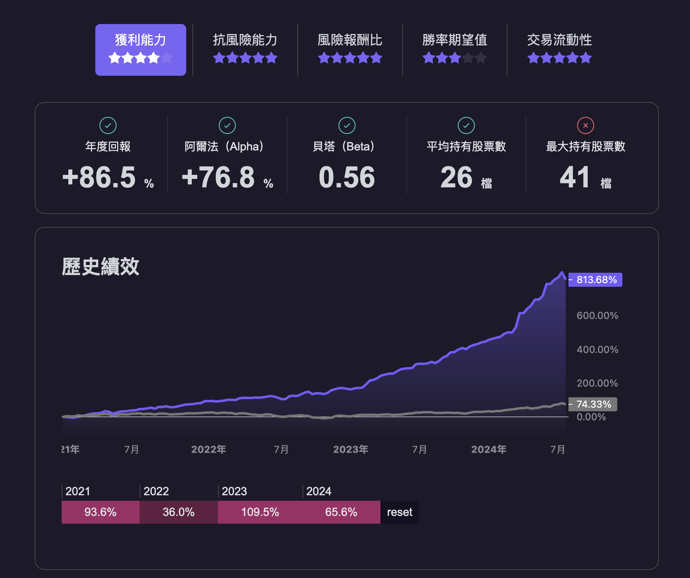

# 下單：多策略

這一頁適合有明確交易策略、想同時跑好幾個策略的人：把策略組成一個投資組合，每天算出整個帳戶該持有的張數，再一次同步到證券帳戶。流程分四步：

1. 執行交易策略
2. 組合交易部位
3. 計算股票張數
4. 實際下單

只有一個策略的話，[下單：單一策略](order_api.md)的做法更簡單。

> [!WARNING]
> **此功能為 BETA 版**
>
> 本功能目前已有上千萬的資金正在使用，但第一次使用時，請於盤後或盤前進行，避免在交易時段操作，以免發生非預期的錯誤。

## 取得每個策略的回測報告

在下一個交易日開盤前，先執行策略並取得交易報告。以下三種方式擇一：

**自己回測**

依[歷史回測](https://studio.finlab.finance/docs/details/backtest)寫好自己的策略，回測取得報告：

```python
from finlab import backtest

# 撰寫您的策略

report1 = backtest.sim(...)
report2 = backtest.sim(...)
```

這種方式需要完整執行程式碼，可能會花費一些時間。
**下載平台上的策略**

在 FinLab Studio 的[策略庫](https://studio.finlab.finance/strategies)選擇想要下單的策略，記下名稱後下載報告：

```python
from finlab.portfolio import create_report_from_cloud

report1 = create_report_from_cloud('NAME_OF_STRATEGY1')
report2 = create_report_from_cloud('NAME_OF_STRATEGY2')
```
**直接指定持股權重**

適合已有持股、希望定期重新平衡的人：

```python
from finlab.portfolio import create_multi_asset_report

report1 = create_multi_asset_report({'2330': 0.5, '1101': 0.5}, resample='Q')
report2 = create_multi_asset_report({'2330': 0.7, '1101': 0.3}, resample='M')
```

`resample` 是重新平衡的頻率，例如 `Q` 表示按季度重新平衡。

## 組合成一個投資組合

用 `Portfolio` 指定每個策略的報告與權重，模擬組合後的績效：

```python
from finlab.portfolio import Portfolio

port = Portfolio({'strategy1': (report1, 0.5), 'strategy2': (report2, 0.5)})
port.display()
```

程式會模擬這兩個策略組合後的部位並計算績效：



幾個策略持有同一檔股票時，組合裡它的權重是各策略權重 × 它在策略裡的權重，再加起來。

## 計算每檔股票的張數

`PortfolioSyncManager`（以下簡稱 PM）負責把投資組合換算成張數：

- 判斷是否需要更新部位
- 在策略換股日，重新計算每檔股票的張數
- 在每個交易日後，檢查是否需要停損或停利
- 在換股時，確保在指定的金額（`total_balance`）內進行換股

> [!CAUTION]
> **一個券商帳戶只交給一個 PortfolioSyncManager**
>
> `sync()` 會把整個帳戶視為這個 PM 的部位，不在目標內的持股都會賣出，下單前也會取消帳戶內的未成交委託。多個策略請合併成一個 `Portfolio` 交給同一個 PM；需要保留的手動持股請放在另一個帳戶。

### 建立或載入 PortfolioSyncManager

第一次使用時建立新的 PM；之後從雲端或本機載入原本的部位：

**第一次建立**

```python
from finlab.portfolio import PortfolioSyncManager

# 建立一個新的資料庫
pm = PortfolioSyncManager()
```
**從雲端載入**

```python
from finlab.portfolio import PortfolioSyncManager

# 從雲端取得原本的部位
pm = PortfolioSyncManager.from_cloud()
```
**從本機載入**

```python
from finlab.portfolio import PortfolioSyncManager

# 從本地端取得原本的部位
pm = PortfolioSyncManager.from_local()
```

### 更新持股

把投資組合與總資金交給 `pm.update()`，依需求選擇更新方式：

**換股日才換股**

```python
# 程式會在換股日當天，才會進行換股，所以第一次創建時，會是空的。
pm.update(port, total_balance=1000000)
```
**零股**

```python
# 零股交易
pm.update(port, total_balance=1000000, odd_lot=True)
```
**融資交易**

```python
# 融資、融券交易
pm.update(port, total_balance=1000000, margin_trading=True)
```

查看更新後的部位：

```python
print(pm)
```

```text
Estimate value 9633950

          quantity  price    weight  close_price    volume                    strategy            type
stock_id
1213          19.0  10.15  0.019055        10.15    69.948                       r2,r3  MARGIN_TRADING
1336           8.0  22.05  0.017430        22.05   270.865                    r5,r6,r7  MARGIN_TRADING
1441          12.0  14.70  0.017430        14.70    76.901                       r0,r8  MARGIN_TRADING
1468           8.0  14.60  0.011541        14.60    33.000                          r9  MARGIN_TRADING
1474           8.0  13.90  0.010987        13.90   113.962                          r1  MARGIN_TRADING
2496          15.0  73.50  0.108936        73.50    11.613     r0,r1,r2,r3,r4,r5,r8,r9  MARGIN_TRADING
3019           3.0  85.90  0.025463        85.90  5376.965                    r3,r4,r5  MARGIN_TRADING
3430           6.0  60.30  0.035749        60.30   300.173                 r4,r5,r6,r7  MARGIN_TRADING
3632          42.0  15.30  0.063494        15.30    15.637        r0,r1,r3,r4,r5,r6,r7  MARGIN_TRADING
4154          20.0  15.75  0.031125        15.75    57.116                 r4,r5,r6,r7  MARGIN_TRADING
4554           3.0  29.50  0.008745        29.50    43.018                          r8  MARGIN_TRADING
```

請每日執行 `PortfolioSyncManager.update`，以確保部位的正確性。

### 儲存部位

**儲存到雲端**

```python
pm.to_cloud()
```
**儲存到本機**

```python
pm.to_local()
```

### 每天自動執行的腳本

第一次請先建立部位並儲存：

```python
# 初始化 PortfolioSyncManager
pm = PortfolioSyncManager()
pm.to_local()
```

之後每天自動執行：

```python
# 初始化 PortfolioSyncManager
pm = PortfolioSyncManager.from_local()

# 相關操作
# pm.update(...)

# 保存最後的操作結果
pm.to_local()
```

> [!NOTE]
> **新增或移除策略**
>
> 每天使用 `pm.update` 時，可以丟入不同的策略、不同的參數來進行不同的操作，它都會用最合理的方式完成部位更新。想要馬上切換策略、不等換股日，可以設定 `pm.update(..., smooth_transition=False)`。

<details><summary>PortfolioSyncManager.update 的參數</summary>

`PortfolioSyncManager.update` 有以下參數，請詳細閱讀確保您的部位更新正確：

**portfolio (Portfolio or Report)**

包含投資組合的資料，是計算股票同步帳戶的核心數據結構，所有股票張數運算都會參考 portfolio 進行。

**total_balance (float)**

總資產的浮點數值，表示投資者的整體資金狀況。這個數值包括所有現金和資產與股票的總和。

`total_balance` 由呼叫端傳入，PM 不會自動讀取券商帳戶。換股時，可用資金取 `total_balance` − 本次不更新策略的持倉市值與本次更新策略權重所對應資金的較小值，再扣除安全現金。

本次確實要重建正權重 sleeve，且 `total_balance` − 本次不更新 sleeve 的持倉市值 <= `1e-6` 時，`update()` 會在寫入任何狀態或重建部位前拋出 `finlab.exceptions.PortfolioError`。`1e-6` 是絕對貨幣容差，遠小於 0.01，用來將等號與十進位價格乘算的微小浮點差一致視為無可用資金；不使用隨資產規模放大的相對容差。沒有 sleeve 要重建、只移除 sleeve 或只處理停損停利的日常更新，不會因持股增值超過固定 `total_balance` 而被此檢查擋住。總額與保留市值皆為 0 的明確零預算沿用原行為。

拋錯會中止**整次** `update()`：不寫入 config/history、不移除或重建部位，也不處理任何 sleeve（包括其他 sleeve）的停損停利。請立即依例外列出的下限調高 `total_balance` 並重跑 `update()`，成功後才儲存或 `sync()`；不要捕捉例外後直接同步舊目標。例：本次不更新持股市值為 600000 時，整數金額至少要 600001 才能通過此邊界檢查，但還需足夠資金購買目標股票與保留安全現金，這個下限不保證買得起一股。實際正餘額不足買一股的空部位問題另由 [Issue #296](https://github.com/finlab-python/finlab/issues/296) 追蹤。希望資金隨帳戶成長時，可傳入 `account.get_total_balance()`。

**rebalance_safety_weight (float)**

現金的權重，確保在以市價買賣資產時，新的策略組合的總價值不會超過原有的組合價值。這個參數是再平衡策略的一部分，用於計算賣出股票後，有多少比例需要轉換成現金。舉例來說，如果設定為 20%，則賣出資產後，20% 的資金將保留為現金，其餘部分將用於購買新的資產。這有助於管理投資風險和確保流動性。假如使用者使用限價交易，可以將此參數設定為 5%。

**smooth_transition (bool)**

此參數決定是否採用平滑過渡的方式進行投資組合更新。當新增或減少策略、以及更新權重時，如果設定為 True，投資組合不會立即變更，而是在每個策略的到期日進行更新。這樣可以避免頻繁的交易，減少交易成本，並有助於投資組合的穩定性。預設值為 True。

**force_override_difference (bool)**

此參數決定是否強制覆蓋現有的不同部位。假如當天不是換股日，而且沒有停損停利，程式還是會驗證當前部位，以及跟模擬部位是否一致（理論上應該一致，但現實上有可能因為資料延遲登載、使用者忘記執行策略、使用者在資料登載前執行策略，而導致稍有不同）。若此參數設定為 True，發現有差異時，則會強制按照新的策略進行調整，預設值為 False，以避免不必要的交易和潛在風險。

這些參數在進行投資組合同步和再平衡時非常重要，正確設定和理解這些參數可以幫助投資者實現更有效的資產管理和風險控制。

</details>

<details><summary>update 怎麼重新分配資金：步驟與實例</summary>

`update` 函數負責維持投資組合平衡，並在需要時依策略分配重新調整。

**步驟**

1. **識別需要更新的策略**
    - 檢查哪些策略的下一個交易日已到或權重已變動。
    - 若啟用 smooth transition，只在下一個預定交易日才更新，避免立即變更。
2. **檢查當前持倉**
    - 比對目前持倉與策略報告；有差異則記錄警告，必要時強制更新。
3. **計算資產價值和流動資金**
    - **總資產價值**：目前所有持倉的總和。
    - **流動資金**：需重新調整的策略持倉價值 + 剩餘餘額。
    - **限制流動資金**：不超過 `total_balance` × 策略權重總和。
    - **安全資金**：流動資金的一個百分比（例如 20%）以維持穩定。
    - **可投資資金**：流動資金扣除安全資金。
4. **更新各策略的持倉**
    - 依策略權重與可投資資金分配資金。
    - 舊持倉清算、新持倉建立；同時出現在新舊持倉中的股票保留。
    - 觸發停損停利的股票直接歸零，不影響整體再平衡。
5. **保存更新後的投資組合**
    - 依初始設定存至本地或雲端。

**實例**

- **初始設置**：策略 A、B，各 50% 權重。
- **當前價值**：總淨值 $1,000,000。策略 A = $300,000（因停損清倉而降低），策略 B = $600,000（因上漲而提高）。
- **重新調整條件**：策略 B 明天換股日，A 不是。

更新過程：

1. 識別到策略 B 需更新。
2. 流動資金：$600,000 + $100,000 剩餘 = $700,000，限制為 $500,000（50% 權重）。
3. 安全資金：$500,000 × 20% = $100,000。
4. 可投資資金：$500,000 - $100,000 = $400,000。
5. 閒置資金 $200,000 大於安全資金 $100,000，不需保留安全資金，可投資資金改為 $500,000。
6. 清算策略 B 原 $600,000 持倉，按策略重新買入 $500,000。
7. 策略 A 中觸發停損停利的股票歸零，不影響 B 的再平衡。

</details>

## 下單並同步帳戶

### 連接券商帳戶

台股支援玉山證券、永豐證券、台新證券（原元富證券）以及富邦證券，美股支援嘉信（Charles Schwab）。帳號密碼設成環境變數，只要設定您需要的券商，不需要多個券商同時串接。

**玉山證券**

[▶ YouTube](https://www.youtube.com/watch?v=AAGcIgJAUVY)

1. 照 [config 教學](https://www.esunsec.com.tw/trading-platforms/api-trading/docs/trading/quick-start/)取得 config 設定檔。
2. 登入[玉山證券 API](https://www.esunsec.com.tw/trading-platforms/api-trading/docs/key/)，取得市場行情 Token。
3. 設定環境變數並連線：

```python
from finlab.online.esun_account import EsunAccount
import os

os.environ['ESUN_CONFIG_PATH'] = '玉山證券交易設定檔(config.ini.example)路徑'
os.environ['ESUN_MARKET_API_KEY'] = '玉山證券的行情API Token'
os.environ['ESUN_ACCOUNT_PASSWORD'] = '玉山證券的帳號密碼'
os.environ['ESUN_CERT_PASSWORD'] = '玉山證券的憑證密碼'

account = EsunAccount()
```

<details><summary>舊版 Fugle 環境變數（仍可使用）</summary>

```python
from finlab.online.fugle_account import FugleAccount
import os

os.environ['FUGLE_CONFIG_PATH'] = '玉山證券交易設定檔(config.ini.example)路徑'
os.environ['FUGLE_MARKET_API_KEY'] = '玉山證券的行情API Token'
os.environ['FUGLE_ACCOUNT_PASSWORD'] = '玉山證券的帳號密碼'
os.environ['FUGLE_CERT_PASSWORD'] = '玉山證券的憑證密碼'

account = FugleAccount()
```

</details>

下單出現錯誤代碼時，可以到[玉山證券文件](https://www.esunsec.com.tw/trading-platforms/api-trading/docs/trading/reference/error-code/)查找原因。不熟悉用 FinLab 套件下單的話，建議先照[券商的教學](https://www.esunsec.com.tw/trading-platforms/api-trading/docs/trading/quick-start/)練習；那邊串接成功，FinLab 套件的串接也是如法炮製。
**永豐證券**

[▶ YouTube](https://www.youtube.com/watch?v=BDsVOI4cZNk)

1. 取得憑證（見永豐官方的[金鑰與憑證申請](https://sinotrade.github.io/zh/tutor/prepare/token/)）：
    - 到永豐理財網的 [API 管理頁面](https://www.sinotrade.com.tw/newweb/PythonAPIKey/)點「下載憑證」，Windows、macOS 都可以下載。
    - 也可以用 eleader 下載憑證，eleader 只支援 Windows。
2. 設定環境變數並連線：

```python
import os
from finlab.online.sinopac_account import SinopacAccount

os.environ['SHIOAJI_API_KEY'] = '永豐證券API_KEY'
os.environ['SHIOAJI_SECRET_KEY'] = '永豐證券SECRET_KEY'
os.environ['SHIOAJI_CERT_PERSON_ID'] = '身份證字號'
os.environ['SHIOAJI_CERT_PATH'] = '永豐證券憑證路徑'
os.environ['SHIOAJI_CERT_PASSWORD'] = '永豐證券憑證密碼'  # 預設與身份證字號相同

account = SinopacAccount()
```

不熟悉用 FinLab 套件下單的話，建議先照[券商的教學](https://sinotrade.github.io/quickstart/)練習；那邊串接成功，FinLab 套件的串接就會非常簡單。
**台新證券（原元富）**

元富證券已於 2026 年 4 月 6 日併入台新證券。詳細步驟見台新官方的[事前準備](https://ml-fugle-api.tssco.com.tw/FugleSDK/docs/trading/prepare/)：

1. **簽署**：線上簽署「API 使用風險暨聲明書」，簽署隔天才生效。
2. **憑證**：用「憑證e管家」申請並匯出 .pfx 憑證檔；用「憑證快遞」申請的憑證不能用在 API。
3. **安裝**：到[台新 SDK 下載頁](https://ml-fugle-api.tssco.com.tw/FugleSDK/docs/download/download-sdk/)下載對應平台的 whl，用 `pip install taishin_sdk-<版本>-cp37-abi3-<平台>.whl` 安裝。官方支援 Python 3.8～3.12。
4. **連線**：

```python
import os
from finlab.online.taishin_account import TaishinAccount

os.environ['TAISHIN_NATIONAL_ID'] = '身分證字號'
os.environ['TAISHIN_ACCOUNT'] = '分公司代號加帳號'  # 不設定就用第一個帳號
os.environ['TAISHIN_ACCOUNT_PASS'] = '登入密碼'
os.environ['TAISHIN_CERT_PATH'] = '憑證檔（.pfx）路徑'
os.environ['TAISHIN_CERT_PASS'] = '憑證密碼'

account = TaishinAccount()

# 第一次使用台新 API 時執行一次，開通 API 資格（成功回傳 True），之後可以刪掉
# account.sdk.register_api_auth(account.target_account)
```

<details><summary>舊版元富環境變數（仍可使用）</summary>

`MasterlinkAccount`（`finlab.online.masterlink_account`）與 `TaishinAccount` 是同一個類別，沒有設定 `TAISHIN_*` 時會讀對應的 `MASTERLINK_*`，例如 `MASTERLINK_NATIONAL_ID`。原本的程式不用改，只要把套件換成 `taishin_sdk`。

</details>

**富邦證券**

請參考[富邦證券的教學](https://www.fbs.com.tw/TradeAPI/docs/trading/introduction/)取得憑證，把憑證放在對應的路徑，安裝相對應的套件後執行：

```python
import os
from finlab.online.fubon_account import FubonAccount

# 設定環境變數
os.environ['FUBON_NATIONAL_ID'] = "A123456789"
os.environ['FUBON_ACCOUNT_PASS'] = "your_password"
os.environ['FUBON_CERT_PATH'] = "/path/to/cert.pfx"
os.environ['FUBON_CERT_PASS'] = "憑證密碼"  # 選填：登入時傳給富邦 SDK 的憑證密碼
os.environ['FUBON_ACCOUNT'] = "帳號"  # 選填：指定帳號，找不到會報錯；不設定就用第一個證券帳戶
# os.environ['FUBON_BASE_URL'] = "連線網址"  # 選填：傳給富邦 SDK（FubonSDK）的連線網址

account = FubonAccount()
```

`FUBON_NATIONAL_ID`、`FUBON_ACCOUNT_PASS`、`FUBON_CERT_PATH` 必須設定，缺少時會報錯；其餘三個是選填。
**Charles Schwab**

嘉信（Charles Schwab）用於美股帳戶：

1. 到 [Schwab Developer Portal](https://developer.schwab.com/) 註冊 app，取得 app key 與 secret。
2. 用 [schwab-py](https://schwab-py.readthedocs.io/) 的登入流程（`pip install schwab-py`）建立 token 檔，`SchwabAccount` 會讀取這個檔案。
3. 設定環境變數並連線：

```python
import os
from finlab.online.schwab_account import SchwabAccount

os.environ['SCHWAB_API_KEY'] = 'Schwab app key'
os.environ['SCHWAB_SECRET'] = 'Schwab app secret'
os.environ['SCHWAB_TOKEN_PATH'] = '/path/to/token.json'

account = SchwabAccount()
```

### 批次下單，與帳戶同步

先用模擬下單確認，再選一種價格方式實際下單：

**模擬下單**

```python
# 不會真的下單，模擬而已
pm.sync(account, view_only=True)
```
**最新價格下單**

```python
# 預設使用最近一筆成交價當成限價
pm.sync(account)
```
**市價單**

```python
# 漲停買入，跌停賣出，針對流動性高的個股較適合
pm.sync(account, market_order=True)
```
**以優勢 1% 限價下單**

```python
# 以優勢 1％ 限價下單 (較容易成交)
pm.sync(account, extra_bid_pct=0.01)
```
**比劣勢 1% 限價掛單**

```python
# 比劣勢 1% 限價掛單(較不容易成交)
pm.sync(account, extra_bid_pct=-0.01)
```

### 更新限價或刪除委託

委託送出後還沒成交時：

```python
# 更新限價
order_executor = pm.create_order_executor(account)
order_executor.update_order_price()

# 刪除所有委託單
order_executor.cancel_orders()
```

### 處置股與警示股要先圈存

若下單部位含有「全額交割股」、「處置股」、「警示股」，需先於證券帳戶圈存。參考[富果圈存](https://support.fugle.tw/trading/trading-troubleshoot/5231/?gclid=CjwKCAiAvK2bBhB8EiwAZUbP1BfmktsP8ULMWOxu0RVhTW3i3Tr_nmAfwhNuKY7635XHCq2J51FmVBoCGwAQAvD_BwE)、[永豐圈存](https://www.sinotrade.com.tw/richclub/freshman/%E6%B0%B8%E8%B1%90%E9%87%91%E8%AD%89%E5%88%B8-%E9%A0%90%E6%94%B6%E6%AC%BE%E5%88%B8-%E6%95%B8%E4%BD%8D%E5%B9%B3%E5%8F%B0%E6%9C%8D%E5%8B%99%E5%85%A5%E5%8F%A3%E4%BB%8B%E7%B4%B9-%E6%83%B3%E8%B2%B7%E8%99%95%E7%BD%AE%E8%82%A1%E5%85%88%E7%9C%8B%E9%80%99%E4%B8%80%E7%AF%87--60ee886daefbe326a0c7bb1b)方式。`order_executor.show_alerting_stocks()`（只適用台股）會列出待下單股票中的處置股與警示股。

## 下一步

- [下單：單一策略](order_api.md) Position 與 OrderExecutor 的用法，以及下單常見錯誤。
- [換股期間與資料就緒](https://studio.finlab.finance/docs/details/trading-calendar-readiness) 換股從何時開始、為什麼每天都要執行 update()。
- [多策略組合](https://studio.finlab.finance/docs/workflows/multi_strategy_portfolio) 合併三個策略的完整流程：配置權重、檢查風險、每天自動同步。
- [finlab.portfolio API](https://studio.finlab.finance/docs/reference/portfolio) Portfolio 與 PortfolioSyncManager 的完整參數。
